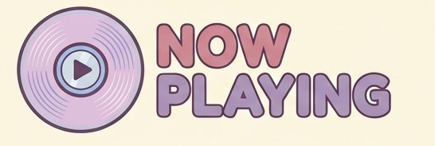

<h1>NOW PLAYING</h1>

<strong>You heard it. Now prove it.</strong>

  
  

### What is Now Playing? 
Now Playing is a music recognition game inspired by the feeling of hearing the first few seconds of a song and immediately knowing what it is.

Players listen to short song previews and race against the clock to identify the track. The faster you recognize it, the more points you earn.
